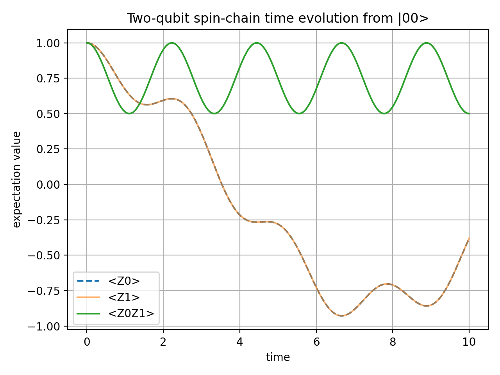
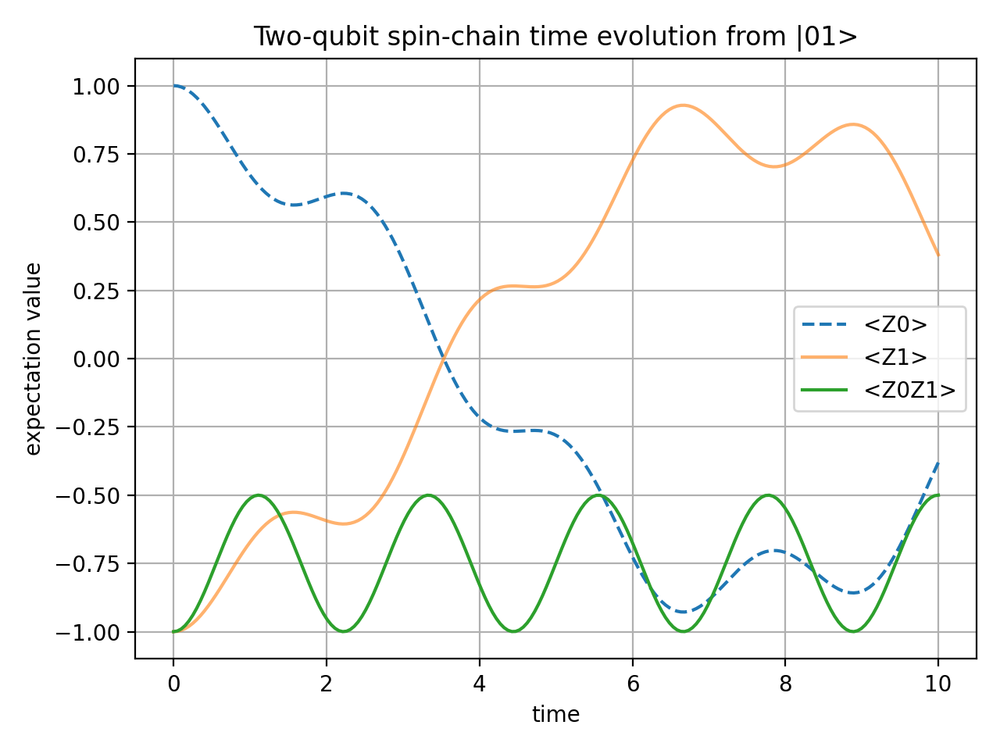
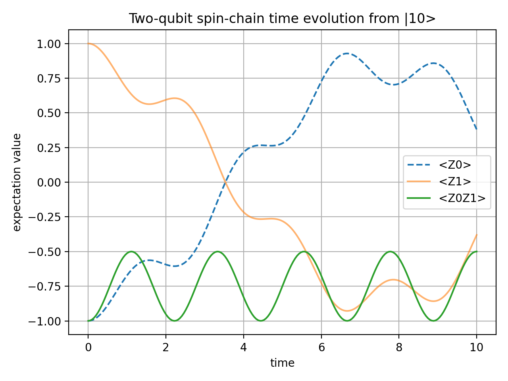
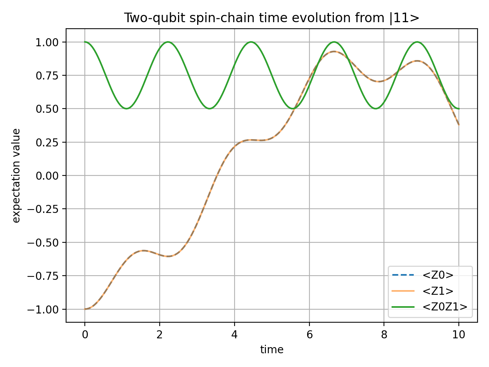

# Two-Qubit Spin-Chain Time Evolution

Two-qubit Hamiltonian simulation using NumPy exact evolution and Qiskit statevector circuits.

## Project Goal

This project simulates the time evolution of a two-qubit spin-chain model. It contains two completed implementations: a NumPy/SciPy exact statevector simulation and a Qiskit circuit-based statevector simulation.

The completed project scope is limited to exact NumPy simulation and Qiskit statevector simulation. It does not include Qiskit Aer backends, noise models, shot-based sampling, or Trotter error analysis.

The main goal is to build a small but complete quantum simulation workflow:

- define a Hamiltonian
- choose initial quantum states
- compute time evolution
- calculate expectation values
- plot and interpret the results
- reproduce the same model using Qiskit statevector circuits

## Repository Structure

```text
.
|-- scripts/
|   |-- Two_qubit_Numpy_evolution.py    # NumPy/SciPy exact matrix-exponential simulation
|   `-- Two_qubit_Qiskit_circuit.py     # Qiskit circuit statevector simulation and validation
|-- figures/
|   |-- Numpy_Simulation/               # PNG plots generated by the NumPy script
|   `-- Qiskit_Simulation/              # PNG plots generated by the Qiskit script
|-- requirements.txt                    # pip dependencies
|-- environment.yml                     # Conda environment wrapper around requirements.txt
|-- LEARNING_NOTES.md                   # Learning process and AI-assisted development boundaries
`-- README.md                           # Main project description
```

## Model

The Hamiltonian used in this project is

```text
H = J Z0Z1 + h(X0 + X1)
```

where:

- `Z0Z1` describes the interaction between the two qubits
- `X0 + X1` describes the transverse field acting on both qubits
- `J = 1.0` is the interaction strength
- `h = 0.5` is the transverse-field strength

The exact time evolution is calculated as

```text
|psi(t)> = exp(-iHt)|psi(0)>
```

The current observables are:

- `<Z0>(t)`: expectation value of qubit 0 in the Z direction
- `<Z1>(t)`: expectation value of qubit 1 in the Z direction
- `<Z0Z1>(t)`: two-qubit correlation observable

## Stage 1: NumPy Exact Simulation

### Reason to Start with NumPy

Although the project also implements the model using Qiskit, the NumPy simulation provides an exact reference result for the Qiskit simulation.

In the NumPy stage, the two-qubit quantum state is represented directly as a four-dimensional statevector. The Hamiltonian is represented as a `4x4` matrix, and the time-evolution operator is computed directly as:

```text
U(t) = exp(-iHt)
```

This is the standard matrix-based form of quantum time evolution. For a two-qubit system, the matrix is small enough that this exact calculation is straightforward and reliable.

The Qiskit stage then implements the same Hamiltonian dynamics using a quantum-circuit representation. In this project, Qiskit is still run on a classical computer simulator, but it expresses the time evolution in terms of quantum gates and circuits rather than direct matrix exponentiation.

Therefore, the NumPy result is used as the reference answer:

- NumPy gives the exact matrix-exponential result.
- Qiskit translates the same time evolution into a circuit-based simulation.

In short, the NumPy stage answers what the Qiskit simulation should reproduce.

### Construction

The NumPy version directly constructs the Pauli matrices, tensor-product operators, Hamiltonian matrix, and time-evolution operator. It then evaluates the expectation values for four computational-basis initial states:

- `|00>`
- `|01>`
- `|10>`
- `|11>`

The current script is:

```text
scripts/Two_qubit_Numpy_evolution.py
```

The output figures are saved in:

```text
figures/Numpy_Simulation
```

### Results

#### Initial State `|00>`



#### Initial State `|01>`



#### Initial State `|10>`



#### Initial State `|11>`



### Observations

For the symmetric Hamiltonian `H = J Z0Z1 + h(X0 + X1)`, the dynamics is invariant under the exchange of qubit 0 and qubit 1. Therefore, the initial states `|01>` and `|10>` give symmetric expectation-value curves, with `<Z0>` and `<Z1>` interchanged.

The observable `<Z0Z1>` measures the correlation between the two qubits. It starts from `+1` for the aligned states `|00>` and `|11>`, and from `-1` for the anti-aligned states `|01>` and `|10>`. During the time evolution, `<Z0Z1>` oscillates while preserving the qualitative distinction between initially aligned and anti-aligned configurations in this parameter setting.

## Stage 2: Qiskit Circuit Simulation

The Qiskit version reproduces the same Hamiltonian dynamics using Qiskit circuits, `PauliEvolutionGate`, `SparsePauliOp`, and statevector simulation.

The current script is:

```text
scripts/Two_qubit_Qiskit_circuit.py
```

The output figures are saved in:

```text
figures/Qiskit_Simulation
```

This stage uses the same model, initial states, and observables as the NumPy exact simulation. The script also checks that the Qiskit circuit results match the direct matrix-exponential reference within numerical tolerance.

## Numerical Checks

Both scripts include numerical checks with a tolerance of `1e-10`.

The NumPy script checks:

- statevector norm preservation for each initial state
- symmetry between `<Z0>` and `<Z1>` for the aligned initial states `|00>` and `|11>`
- swap symmetry between the anti-aligned initial states `|01>` and `|10>`

The Qiskit script checks the same properties and also compares the Qiskit circuit statevector results against a direct matrix-exponential reference for `<Z0>`, `<Z1>`, and `<Z0Z1>` across all four initial states.

If a check fails, the script raises an assertion error with the maximum numerical error. A successful Qiskit run prints:

```text
Qiskit circuit numerical checks passed.
```

## How to Run

This project should be run in a project-specific Python environment. PyCharm may use a different interpreter from the `python` command in a normal terminal, so always check which Python is active before running the script.

Recommended Python version:

```text
Python 3.11
```

### Option 1: Conda environment

Create the environment:

```bash
conda env create -f environment.yml
```

Activate it:

```bash
conda activate qclp-qiskit
```

Run the current NumPy simulation script:

```bash
python scripts/Two_qubit_Numpy_evolution.py
```

Run the Qiskit circuit simulation script:

```bash
python scripts/Two_qubit_Qiskit_circuit.py
```

### Option 2: Existing Python environment

If you already have a suitable Python environment, activate it first, then install the dependencies:

```bash
pip install -r requirements.txt
```

Run the current NumPy simulation script:

```bash
python scripts/Two_qubit_Numpy_evolution.py
```

Run the Qiskit circuit simulation script:

```bash
python scripts/Two_qubit_Qiskit_circuit.py
```

To check which Python is being used:

```bash
python -c "import sys; print(sys.executable)"
```

To check whether the required packages are installed:

```bash
python -c "import numpy, scipy, matplotlib, qiskit; print('environment ok')"
```

## Expected Outputs

Running the NumPy script prints:

```text
Numerical checks passed.
Saved .../figures/Numpy_Simulation/Initial_00_expvl.png
Saved .../figures/Numpy_Simulation/Initial_01_expvl.png
Saved .../figures/Numpy_Simulation/Initial_10_expvl.png
Saved .../figures/Numpy_Simulation/Initial_11_expvl.png
```

It generates:

- `figures/Numpy_Simulation/Initial_00_expvl.png`
- `figures/Numpy_Simulation/Initial_01_expvl.png`
- `figures/Numpy_Simulation/Initial_10_expvl.png`
- `figures/Numpy_Simulation/Initial_11_expvl.png`

Running the Qiskit script prints:

```text
Qiskit circuit numerical checks passed.
Saved .../figures/Qiskit_Simulation/Initial_00_expvl.png
Saved .../figures/Qiskit_Simulation/Initial_01_expvl.png
Saved .../figures/Qiskit_Simulation/Initial_10_expvl.png
Saved .../figures/Qiskit_Simulation/Initial_11_expvl.png
```

It generates:

- `figures/Qiskit_Simulation/Initial_00_expvl.png`
- `figures/Qiskit_Simulation/Initial_01_expvl.png`
- `figures/Qiskit_Simulation/Initial_10_expvl.png`
- `figures/Qiskit_Simulation/Initial_11_expvl.png`

## Requirements

Project requirements:

- `numpy`
- `scipy`
- `matplotlib`
- `qiskit`

The NumPy exact simulation uses `numpy`, `scipy`, and `matplotlib`. The Qiskit circuit simulation uses the core `qiskit` package and `Statevector` simulation from `qiskit.quantum_info`.


## AI Assistance Disclosure

AI was used for the following items:

- Constructing initial project structure and documentation framework
- NumPy and Qiskit code generation and modification

The remaining work was completed by the author, including conceptual learning, documentation review and revision, Git repository setup, commit management, and upload operations.

The author reviewed, tested, and edited the AI-assisted code and project structure, and takes responsibility for the final implementation, results, and repository content.

For more details, see [LEARNING_NOTES.md](LEARNING_NOTES.md).


## Completion Status

NumPy exact simulation provides the reference result, and the Qiskit circuit simulation reproduces the same dynamics within numerical tolerance.

## Future Work

The current project is complete within its intended scope. Possible local extensions that are not included in this version are:

- Trotter error analysis for comparing exact evolution with product-formula approximations.
- Parameter sweeps over different `J`, `h`, and total evolution time.
- Extension from two qubits to small spin chains.
- Additional observables, such as entanglement entropy or state fidelity.
