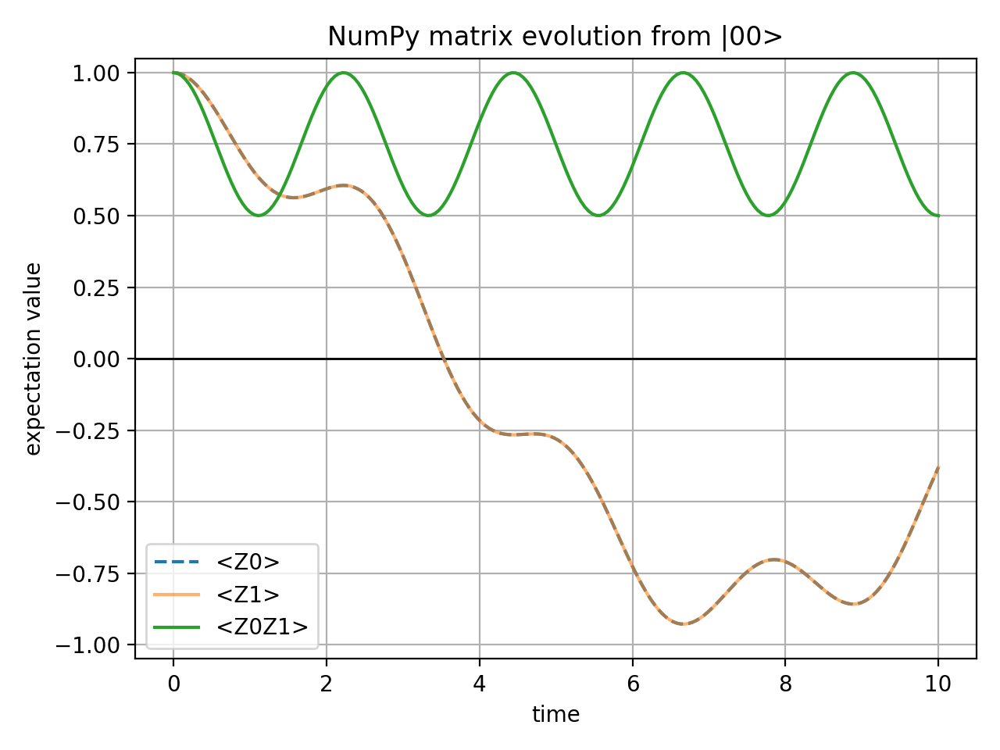
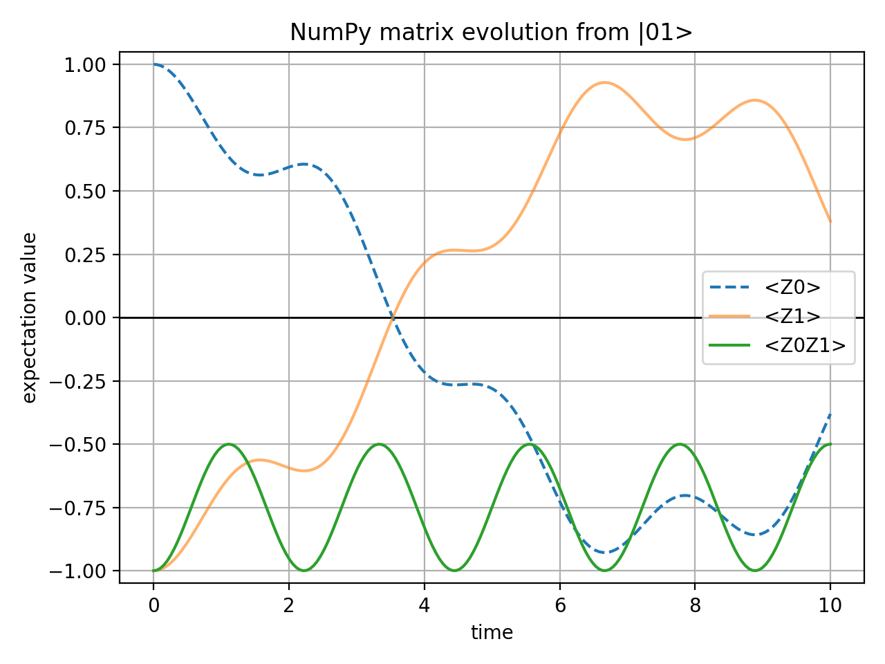
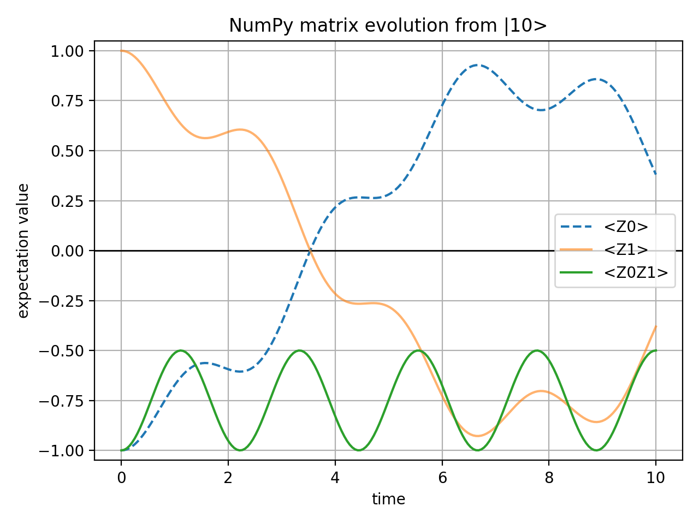
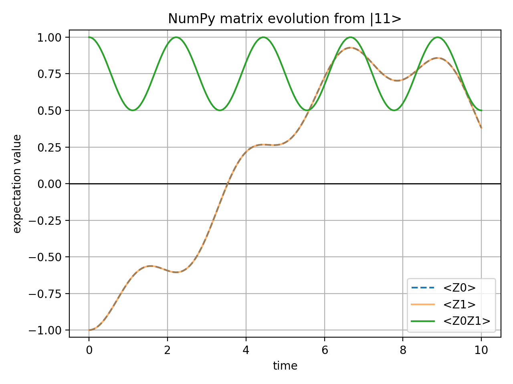

# Two-Qubit Spin-Chain Time Evolution

Two-qubit Hamiltonian simulation using NumPy matrix simulation and Qiskit circuit simulation.

> **AI assistance:** AI was used for the project structure, document framework, and NumPy/Qiskit code development.
> See [AI Assistance Disclosure](#ai-assistance-disclosure) for details.

## Project Overview

This project is an AI-assisted introductory self-learning project in quantum computing. 
It aims to understand quantum simulation workflow through mathematical reasoning, code interpretations and numerical validation.
It simulates the time evolution of a two-qubit spin-chain model in two versions: 
a NumPy/SciPy exact matrices simulation and a Qiskit circuit-based statevector simulation.

The main goal is to build a small quantum simulation workflow:
- Define the model Hamiltonian
- Choose initial quantum states
- Compute the time evolution of initial states
- Calculate three expectation values for each state
- Plot and interpret the results
- Reproduce the same model using Qiskit circuit simulation

For the scope and extensions of this project, see [Completion Status](#completion-status) and [Possible Extensions](#possible-extensions).

For detailed learning notes and model interpretation, read the [compiled PDF](learning_notes.pdf), 
and the corresponding LaTeX source is [learning_notes.tex](learning_notes.tex).

## Repository Structure

```text
.
|-- scripts/
|   |-- two_qubit_numpy_matrix.py        # NumPy/SciPy matrix-exponential simulation
|   `-- two_qubit_qiskit_circuit.py # Qiskit circuit statevector simulation and validation
|-- figures/
|   |-- numpy_matrix/                    # PNG plots generated by the NumPy script
|   `-- qiskit_circuit/             # PNG plots generated by the Qiskit script
|-- requirements.txt                    # pip dependencies
|-- environment.yml                     # Conda environment wrapper around requirements.txt
|-- learning_notes.tex                  # Conceptual learning notes and model interpretation
|-- learning_notes.pdf                  # Compiled reading copy
`-- README.md                           # Main project description
```

## Model

The Hamiltonian of this project is
```text
H = J Z0Z1 + h(X0 + X1)
```

where:
- `Z0Z1` describes the interaction between the two qubits
- `X0 + X1` describes the transverse field acting on both qubits
- `J = 1.0` is the interaction strength
- `h = 0.5` is the transverse-field strength

The time evolution is
```text
|ψ(t)> = exp(-iHt) |ψ(0)>
```

The current observables are:
- `<Z0>(t)`: expectation value of qubit 0 in the Z direction
- `<Z1>(t)`: expectation value of qubit 1 in the Z direction
- `<Z0Z1>(t)`: two-qubit correlation observable

### Qubit Labeling Convention
Generally, Qiskit writes a two-qubit basis state as `|q_1q_0>`, 
where `q_1` is the left bit, and `q_0` is the right bit.

This project writes state strings from left to right as `|q0 q1>`, with
qubit 0 on the left and qubit 1 on the right. 
Relative to Qiskit's convention, the labels in this project are mapped as:
- `q_0` (project) = `q_1` (Qiskit) 
- `q_1` (project) = `q_0` (Qiskit) 

and the observables map to Qiskit Pauli labels as:
- `<Z0>` → `"ZI"`
- `<Z1>` → `"IZ"`
- `<Z0Z1>` → `"ZZ"`

## Stage 1: NumPy Exact Simulation

### Reason to Include a NumPy Version

The NumPy script constructs the project model directly with explicit matrices, and computes the target variables. 
Since this method doesn't rely on Qiskit’s circuits, it serves as a numerical reference for results of the Qiskit script.
```text
U(t) = exp(-iHt)
```
at 200 equally spaced time points from `t = 0` to `t = 10`.

After creating and activating the project environment, run:
```bash
python scripts/two_qubit_numpy_matrix.py
```
The NumPy script runs the simulation from each basis state. It calculates `<Z0>`, `<Z1>`, `<Z0Z1>` 
while checking their values at the start of the simulation. 

The four plots are saved in `figures/numpy_matrix/`, which can be compared with the Qiskit plots to check 
how the model is implemented: whether the curve shapes, initial values, and symmetry properties of two versions agree with each other.

This version defines the Hamiltonian only with NumPy/SciPy matrices, providing an independent reference 
for the comparison with the Qiskit circuit version shown later.

### Construction

The NumPy version directly constructs the Pauli matrices, tensor-product operators, Hamiltonian matrix, 
and time-evolution operator, then evaluates the expectation values for four basis initial states:
- `|00>`
- `|01>`
- `|10>`
- `|11>`

The current script is:
```text
scripts/two_qubit_numpy_matrix.py
```
The output figures are saved in:
```text
figures/numpy_matrix
```

### Results

#### Initial State `|00>`



#### Initial State `|01>`



#### Initial State `|10>`



#### Initial State `|11>`



### Observations

The Hamiltonian `H = J Z0Z1 + h(X0 + X1)` remains unchanged when qubit 0 and qubit 1 are exchanged. 
Therefore, the initial states `|01>` and `|10>` give symmetric expectation-value curves, with `<Z0>` and `<Z1>` interchanged.

The observable `<Z0Z1>` measures the correlation between the two qubits. It starts from `+1` for the aligned states `|00>` and `|11>`, 
and from `-1` for the anti-aligned states `|01>` and `|10>`. Under this `J`, `h` setting, `<Z0Z1>` oscillates during the time evolution, 
and the corresponding curves of aligned initial states remain positive, while those of anti-aligned initial states remain negative.

## Stage 2: Qiskit Circuit Simulation

The Qiskit version calculates the same time evolution using Qiskit circuits, statevector simulation, 
`SparsePauliOp`, `PauliEvolutionGate` with `MatrixExponential` synthesis.

The current script is:
```text
scripts/two_qubit_qiskit_circuit.py
```

The output figures are saved in:
```text
figures/qiskit_circuit
```

The Qiskit script uses the same initial states, observables and time grid as the NumPy version, 
with a cross-script numerical comparison against the NumPy results.

## Numerical Checks

Both scripts make numerical checks with a tolerance of `1e-10`
- Statevector normalization for each initial state at every time points
- Expected values of `<Z0>`, `<Z1>`, and `<Z0Z1>` at `t = 0`
- Coincidence of `<Z0>` and `<Z1>` within each aligned-state plot, and sign reversal between two aligned state plots
- Sign reversal of `<Z0>` and `<Z1>` within each anti-aligned state plot, and sign reversal between two anti-aligned state plots
- Coincidence of `<Z0Z1>` between `|00>` and `|11>`, and between `|01>` and `|10>`
- Sign reversal of `<Z0Z1>` between `|01>` and `|00>`, and between `|10>` and `|11>`

The Qiskit script additionally compares its three expectation values with the NumPy results for 
all basis initial states at all 200 time points. Each comparison requires a maximum absolute difference below 1e-10.

A successful Qiskit run prints:
```text
Max Qiskit vs NumPy observable error: <actual error> (tolerance 1.0e-10)
Qiskit circuit numerical checks passed.
```

If a check fails, the script will report an `AssertionError` with the maximum absolute error of the failed check. 

## How to Run

This project should be run in a Python environment specifically arranged for the project. 
PyCharm might be used as an interpreter different from the `python` command in a normal terminal, 
so before running the script, double-check which Python interpreter is active.

Recommended and verified Python version:
```text
Python 3.11.15
```

### Option 1: Create a Conda Environment (Recommended for Reproduction)

This method is recommended if you have a new machine or require a clean reproduction of the project.

Create the environment:

```bash
conda env create -f environment.yml
```

Activate it:
```bash
conda activate qclp-qiskit
```

Run the current NumPy simulation script:
```bash
python scripts/two_qubit_numpy_matrix.py
```

Run the Qiskit circuit simulation script:
```bash
python scripts/two_qubit_qiskit_circuit.py
```

### Option 2: Use an Existing Python Environment

This method is recommended if you have a Python environment with a compatible Python version already.

Activate it first, then install the following dependencies:

```bash
pip install -r requirements.txt
```

Run the current NumPy simulation script:

```bash
python scripts/two_qubit_numpy_matrix.py
```

Run the Qiskit circuit simulation script:

```bash
python scripts/two_qubit_qiskit_circuit.py
```

To check which Python is being used:

```bash
python -c "import sys; print(sys.executable)"
```

To check whether the required packages are installed:

```bash
python -c "import numpy, scipy, matplotlib, qiskit; print('environment ok')"
```

## Expected Outputs

Running the NumPy script prints:
```text
Numerical checks passed.
Saved .../figures/numpy_matrix/Initial_00_expvl_matrix.png
Saved .../figures/numpy_matrix/Initial_01_expvl_matrix.png
Saved .../figures/numpy_matrix/Initial_10_expvl_matrix.png
Saved .../figures/numpy_matrix/Initial_11_expvl_matrix.png
```

It generates:
- `figures/numpy_matrix/Initial_00_expvl_matrix.png`
- `figures/numpy_matrix/Initial_01_expvl_matrix.png`
- `figures/numpy_matrix/Initial_10_expvl_matrix.png`
- `figures/numpy_matrix/Initial_11_expvl_matrix.png`

Running the Qiskit script prints:
```text
Max Qiskit vs NumPy observable error: <actual error> (tolerance 1.0e-10)
Qiskit circuit numerical checks passed.
Saved .../figures/qiskit_circuit/Initial_00_expvl_circuit.png
Saved .../figures/qiskit_circuit/Initial_01_expvl_circuit.png
Saved .../figures/qiskit_circuit/Initial_10_expvl_circuit.png
Saved .../figures/qiskit_circuit/Initial_11_expvl_circuit.png
```

It generates:
- `figures/qiskit_circuit/Initial_00_expvl_circuit.png`
- `figures/qiskit_circuit/Initial_01_expvl_circuit.png`
- `figures/qiskit_circuit/Initial_10_expvl_circuit.png`
- `figures/qiskit_circuit/Initial_11_expvl_circuit.png`

After saving the PNG files, both scripts display the plots when a graphical Matplotlib backend is available. 
The scripts finish after the plot windows are closed. When a graphical backend is not available, 
both scripts save the PNG files without displaying plot windows and then finish automatically.

## Requirements

Project environment versions:
- `Python 3.11.15`
- `NumPy 2.4.4`
- `SciPy 1.17.1`
- `Matplotlib 3.10.9`
- `Qiskit 2.4.1`

The NumPy script uses NumPy for matrices and numerical calculations, SciPy for matrix exponentiation, and Matplotlib for plotting.
The Qiskit script uses the Qiskit package to build circuits and to run statevector simulations, NumPy for numerical checks, and Matplotlib for plotting.

## AI Assistance Disclosure

AI was used for the following items:
- Constructing initial project structure and documentation framework
- NumPy and Qiskit code generation and modification

The author independently handled the conceptual learning, documentation review and revision, 
Git repository setup, commit management, and upload operations.
The author also read, tested the scripts, observed their results, and adjusted the repository’s structure.

The author takes responsibility for the final scripts with their results, and repository content.

## Completion Status

The project includes:
- NumPy/SciPy exact matrix simulation
- Qiskit circuit statevector simulation
- Numerical validation
- Numerical comparison of NumPy and Qiskit results
- Expectation value plots

The NumPy script provides an independent matrix reference, 
and the Qiskit script compares its circuit results with this reference.

## Possible Extensions

Possible extensions in this version are:
- Trotter error analysis for comparing exact evolution with product-formula approximations
- Parameter sweeps over different `J`, `h`, and total evolution time
- Extension from two qubits to small spin chains
- Additional observables, such as entanglement entropy or state fidelity
- Qiskit Aer simulations with shot-based sampling and noise models

## Usage

This repository is maintained as a record of the author's personal learning
and development process.

Personal, non-commercial use for private learning is permitted, including
downloading, running, and locally modifying the contents of this repository.

Redistribution of the original or modified contents, publication of derivative
versions, incorporation into other public projects, and commercial use are not
authorized. No permission is granted to reproduce or reuse repository contents
in teaching materials, publications, or other publicly distributed materials.

Copyright © 2026 Yutong Liu (GitHub: [IceYi233](https://github.com/IceYi233)).
All rights reserved.

## Contributions

This repository is maintained ONLY by the author as a personal learning
project. External contributions, pull requests for project are not accepted.