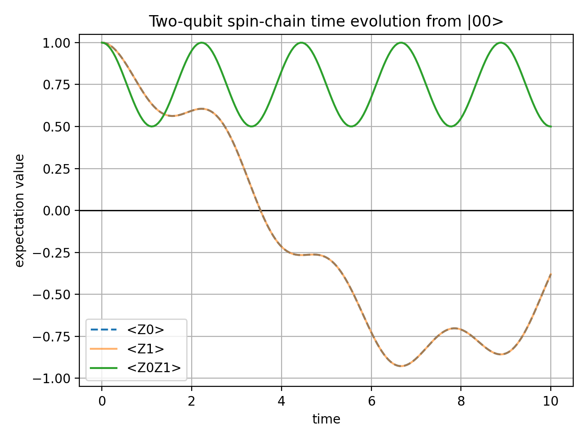
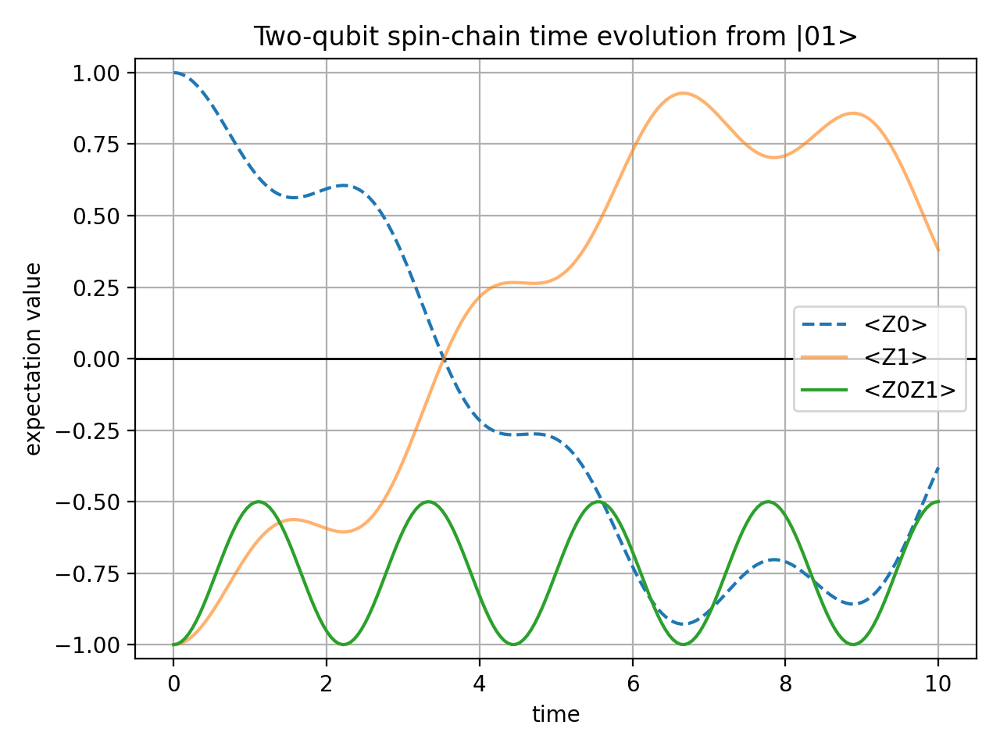
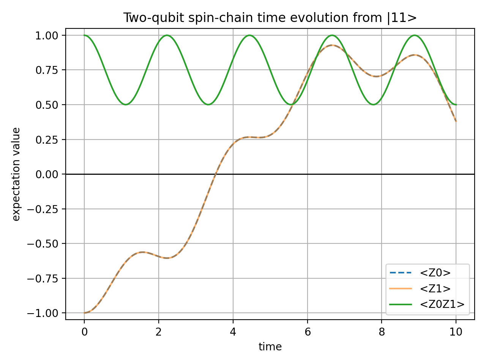

# Two-Qubit Spin-Chain Time Evolution

Two-qubit Hamiltonian simulation using NumPy exact evolution and Qiskit statevector circuits.

> **AI assistance:** AI was used for the initial project structure, documentation framework, and NumPy/Qiskit code development.
> See [AI Assistance Disclosure](#ai-assistance-disclosure) for details.

## Project Goal

This project simulates the time evolution of a two-qubit spin-chain model. It contains two completed implementations: 
a NumPy/SciPy exact statevector simulation and a Qiskit circuit-based statevector simulation.

The completed project scope is limited to exact NumPy simulation and Qiskit statevector simulation. 
It does not include Qiskit Aer backends, noise models, shot-based sampling, or Trotter error analysis.

The main goal is to build a small but complete quantum simulation workflow:

- define a Hamiltonian
- choose initial quantum states
- compute time evolution
- calculate expectation values
- plot and interpret the results
- reproduce the same model using Qiskit statevector circuits

## Repository Structure

```text
.
|-- scripts/
|   |-- two_qubit_numpy_exact.py        # NumPy/SciPy exact matrix-exponential simulation
|   `-- two_qubit_qiskit_statevector.py # Qiskit circuit statevector simulation and validation
|-- figures/
|   |-- numpy_exact/                    # PNG plots generated by the NumPy script
|   `-- qiskit_statevector/             # PNG plots generated by the Qiskit script
|-- requirements.txt                    # pip dependencies
|-- environment.yml                     # Conda environment wrapper around requirements.txt
|-- learning_notes.tex                  # Conceptual learning notes and model interpretation
|-- learning_notes.pdf                  # Compiled reading copy
`-- README.md                           # Main project description
```

## Model

The Hamiltonian used in this project is

```text
H = J Z0Z1 + h(X0 + X1)
```

where:

- `Z0Z1` describes the interaction between the two qubits
- `X0 + X1` describes the transverse field acting on both qubits
- `J = 1.0` is the interaction strength
- `h = 0.5` is the transverse-field strength

The exact time evolution is calculated as

```text
|ψ(t)> = exp(-iHt)|ψ(0)>
```

The current observables are:

- `<Z0>(t)`: expectation value of qubit 0 in the Z direction
- `<Z1>(t)`: expectation value of qubit 1 in the Z direction
- `<Z0Z1>(t)`: two-qubit correlation observable

### Qubit Labeling Convention

This project writes state strings from left to right as `|q0 q1>`:
qubit 0 is on the left and qubit 1 is on the right. 
For example, `|01>` means q0 = 0 and q1 = 1.

Generally, Qiskit uses the opposite ordering: in Qiskit labels and state strings,
the right position corresponds to circuit qubit 0 and the left position corresponds to circuit qubit 1.
Therefore:

- project `q0` (left) = Qiskit circuit qubit 1
- project `q1` (right) = Qiskit circuit qubit 0

and the observables map to Qiskit Pauli labels as:

- `<Z0>` → `"ZI"`
- `<Z1>` → `"IZ"`
- `<Z0Z1>` → `"ZZ"`

## Stage 1: NumPy Exact Simulation

### Reason to Include a NumPy Version

The NumPy script provides a direct implementation of the project model. 
It defines the Pauli matrices as NumPy arrays, constructs the two-qubit Hamiltonian with tensor products, 
and calculates the standard matrix-based form of quantum time evolution
```text
U(t) = exp(-iHt)
```
at 200 equally spaced time points from `t = 0` to `t = 10`.

After creating and activating the project environment, run:
```bash
python scripts/two_qubit_numpy_exact.py
```
The script simulates the four basis initial states, calculates `<Z0>`, `<Z1>`, and `<Z0Z1>`, and checks the initial values. 
It saves four figures in `figures/numpy_exact/`, 
which can be compared with figures produced by the Qiskit script to check whether both implementations translate the model accurately
and yield the same curve shapes, initial values, and symmetry properties.

Meanwhile, since the NumPy script uses only ordinary NumPy/SciPy matrices,
it provides another model definition without depending on Qiskit’s conventions and 
serves as a standalone reproducible version independent of Qiskit.

### Construction

The NumPy version directly constructs the Pauli matrices, tensor-product operators, Hamiltonian matrix, and time-evolution operator. 
It then evaluates the expectation values for four computational-basis initial states:

- `|00>`
- `|01>`
- `|10>`
- `|11>`

The current script is:
```text
scripts/two_qubit_numpy_exact.py
```
The output figures are saved in:
```text
figures/numpy_exact
```

### Results

#### Initial State `|00>`



#### Initial State `|01>`



#### Initial State `|10>`


#### Initial State `|11>`



### Observations

The Hamiltonian `H = J Z0Z1 + h(X0 + X1)` is unchanged when qubit 0 and qubit 1 are exchanged. 
Therefore, the initial states `|01>` and `|10>` give symmetric expectation-value curves, with `<Z0>` and `<Z1>` interchanged.

The observable `<Z0Z1>` measures the correlation between the two qubits. It starts from `+1` for the aligned states `|00>` and `|11>`, 
and from `-1` for the anti-aligned states `|01>` and `|10>`. During the time evolution, `<Z0Z1>` oscillates while 
preserving the qualitative distinction between initially aligned and anti-aligned configurations in this parameter setting.

## Stage 2: Qiskit Circuit Simulation

The Qiskit version calculates the same exact time evolution using Qiskit circuits, `SparsePauliOp`, 
and `PauliEvolutionGate` with `MatrixExponential` synthesis, followed by statevector simulation.

The current script is:

```text
scripts/two_qubit_qiskit_statevector.py
```

The output figures are saved in:

```text
figures/qiskit_statevector
```

This stage uses the same model, initial states, observables and time grid as the NumPy exact simulation. 
The script also checks that the Qiskit expectation-value results match an internal direct matrix-exponential reference 
constructed in the same Qiskit script to within numerical tolerance.

## Numerical Checks

Both scripts include numerical checks with a tolerance of `1e-10`.

The NumPy script checks:

- statevector norm preservation for each initial state
- the expected values of `<Z0>`, `<Z1>`, and `<Z0Z1>` at `t = 0` for all four initial states
- symmetry between `<Z0>` and `<Z1>` for the aligned initial states `|00>` and `|11>`
- swap symmetry of `<Z0>` and `<Z1>` between the anti-aligned initial states `|01>` and `|10>`

The Qiskit script checks the same properties and also compares its expectation-value results against 
an internal direct matrix-exponential reference for `<Z0>`, `<Z1>`, and `<Z0Z1>` across all four initial states.

If a check fails, the script raises an assertion error with the maximum numerical error. A successful Qiskit run prints:

```text
Qiskit circuit numerical checks passed.
```

## How to Run

This project should be run in a project-specific Python environment. 
PyCharm may use a different interpreter from the `python` command in a normal terminal, 
so always check which Python is active before running the script.

Recommended and verified Python version:

```text
Python 3.11.15
```

### Option 1: Create a Conda Environment (Recommended for Reproduction)

This is the recommended approach for a new machine or a clean reproduction of the project.

Create the environment:

```bash
conda env create -f environment.yml
```

Activate it:

```bash
conda activate qclp-qiskit
```

Run the current NumPy simulation script:

```bash
python scripts/two_qubit_numpy_exact.py
```

Run the Qiskit circuit simulation script:

```bash
python scripts/two_qubit_qiskit_statevector.py
```

### Option 2: Use an Existing Python Environment

Use this if you already have a Python environment with a compatible Python version.

Activate it first, then install the dependencies:

```bash
pip install -r requirements.txt
```

Run the current NumPy simulation script:

```bash
python scripts/two_qubit_numpy_exact.py
```

Run the Qiskit circuit simulation script:

```bash
python scripts/two_qubit_qiskit_statevector.py
```

To check which Python is being used:

```bash
python -c "import sys; print(sys.executable)"
```

To check whether the required packages are installed:

```bash
python -c "import numpy, scipy, matplotlib, qiskit; print('environment ok')"
```

## Expected Outputs

Running the NumPy script prints:
```text
Numerical checks passed.
Saved .../figures/numpy_exact/Initial_00_expvl.png
Saved .../figures/numpy_exact/Initial_01_expvl.png
Saved .../figures/numpy_exact/Initial_10_expvl.png
Saved .../figures/numpy_exact/Initial_11_expvl.png
```

It generates:
- `figures/numpy_exact/Initial_00_expvl.png`
- `figures/numpy_exact/Initial_01_expvl.png`
- `figures/numpy_exact/Initial_10_expvl.png`
- `figures/numpy_exact/Initial_11_expvl.png`

Running the Qiskit script prints:
```text
Qiskit circuit numerical checks passed.
Saved .../figures/qiskit_statevector/Initial_00_expvl.png
Saved .../figures/qiskit_statevector/Initial_01_expvl.png
Saved .../figures/qiskit_statevector/Initial_10_expvl.png
Saved .../figures/qiskit_statevector/Initial_11_expvl.png
```

It generates:
- `figures/qiskit_statevector/Initial_00_expvl.png`
- `figures/qiskit_statevector/Initial_01_expvl.png`
- `figures/qiskit_statevector/Initial_10_expvl.png`
- `figures/qiskit_statevector/Initial_11_expvl.png`

After saving the PNG files, both scripts display the plots when a graphical Matplotlib backend is available. 
The scripts finish after the plot windows are closed. When a graphical backend is not available, 
both scripts save the PNG files without displaying plot windows and then finish automatically.

## Requirements

Project environment versions:
- `Python 3.11.15`
- `NumPy 2.4.4`
- `SciPy 1.17.1`
- `Matplotlib 3.10.9`
- `Qiskit 2.4.1`

The NumPy exact simulation uses `NumPy`, `SciPy`, and `Matplotlib`.
The Qiskit circuit simulation uses `NumPy` for numerical calculations, `SciPy` for the internal matrix-exponential reference,
`Matplotlib` for plotting, and the core `Qiskit` package for circuit construction and statevector simulation.


## AI Assistance Disclosure

AI was used for the following items:

- Constructing initial project structure and documentation framework
- NumPy and Qiskit code generation and modification

The author independently handled the conceptual learning, documentation review and revision, 
Git repository setup, commit management, and upload operations.

The author reviewed, tested, and edited the AI-assisted code and project structure, 
and takes responsibility for the final implementation, results, and repository content.

For detailed learning notes and model interpretation, read the [compiled PDF](learning_notes.pdf).
The canonical LaTeX source is available in [learning_notes.tex](learning_notes.tex).

## Completion Status

The NumPy implementation provides a separate exact calculation of the model. 
The Qiskit circuit simulation produces the model's time-evolution results and is validated within numerical tolerance 
against an internal direct matrix-exponential reference constructed within the Qiskit script.

## Possible Extensions

The current project is complete within its intended scope. 
Possible local extensions that are not included in this version are:

- Trotter error analysis for comparing exact evolution with product-formula approximations.
- Parameter sweeps over different `J`, `h`, and total evolution time.
- Extension from two qubits to small spin chains.
- Additional observables, such as entanglement entropy or state fidelity.
